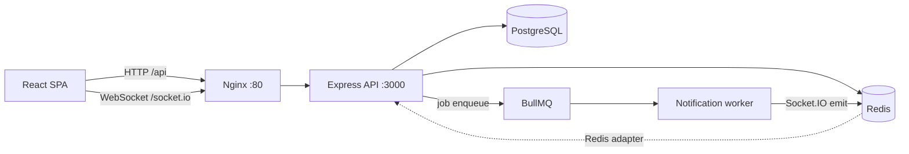
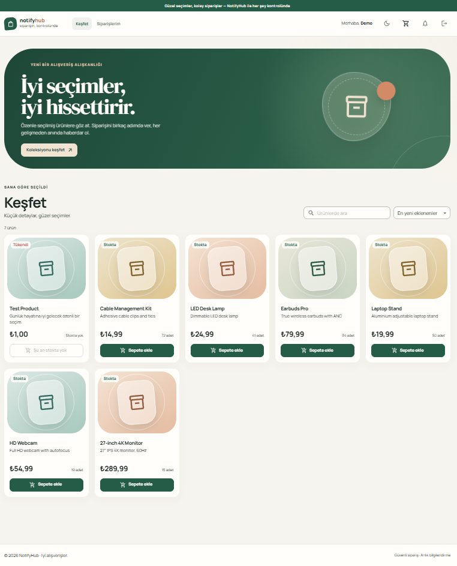
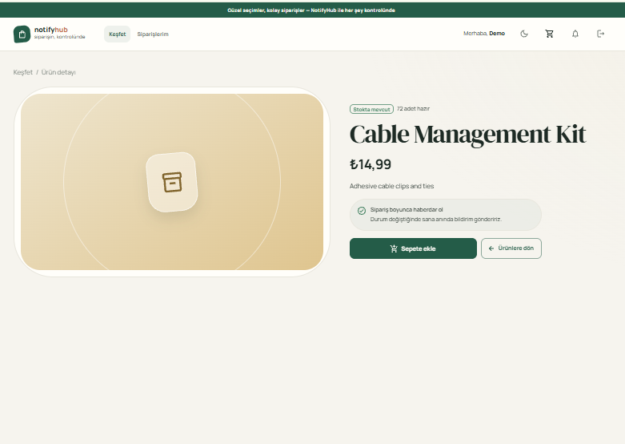
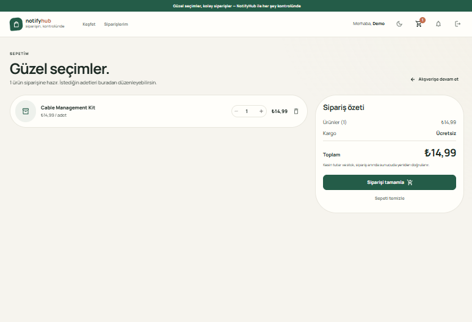
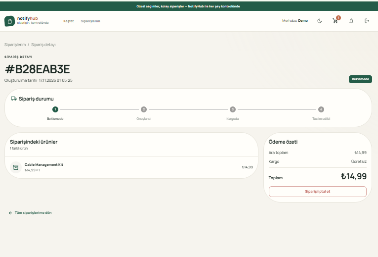
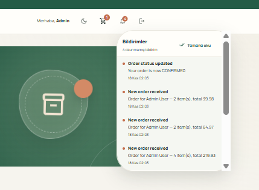
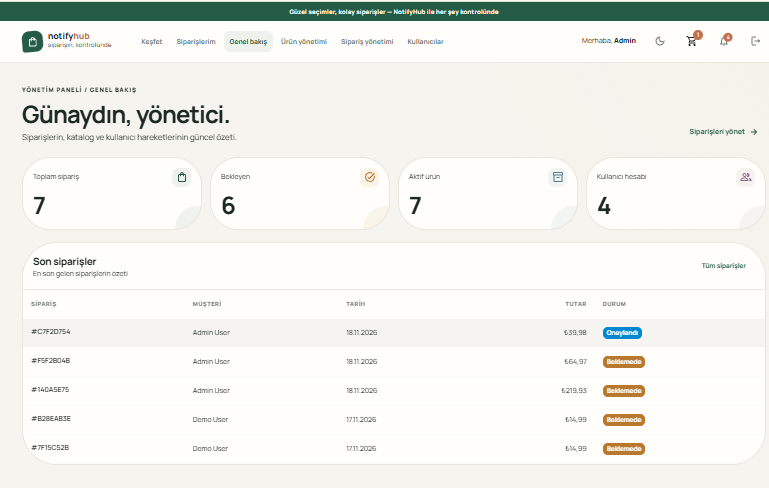

# NotifyHub


Gerçek zamanlı sipariş bildirim platformu. Kullanıcılar ürünleri inceler, sepete ekler ve sipariş verir; yöneticiler yeni siparişleri **anlık bildirim** olarak görür ve sipariş durumunu güncelleyince kullanıcıya da anlık bildirim gider.

> Bu proje, 2024'te yazılmış `My-Notification-App` projesinin modern, tip güvenli ve production seviyesinde baştan yazılmış halidir.

## Teknolojiler

| Katman         | Teknoloji                                                                   |
| -------------- | --------------------------------------------------------------------------- |
| Dil            | TypeScript (strict)                                                         |
| Backend        | Node.js 22 LTS, Express 5, Prisma ORM, Zod                                  |
| Veritabanı     | PostgreSQL 17                                                               |
| Cache / Kuyruk | Redis 7, BullMQ                                                             |
| Gerçek zamanlı | Socket.IO                                                                   |
| Frontend       | React 19, Vite, MUI, React Router, TanStack Query, React Hook Form, Zustand |
| Test           | Vitest, Supertest, React Testing Library                                    |
| Kalite         | ESLint, Prettier, Husky, lint-staged, Conventional Commits                  |
| Altyapı        | Docker, Docker Compose, Nginx, GitHub Actions                               |
| Dokümantasyon  | OpenAPI (Swagger UI)                                                        |

## Mimari



## Ekran görüntüleri

| Storefront                           | Ürün detayı                                   | Sepet                          |
| ------------------------------------ | --------------------------------------------- | ------------------------------ |
|  |  |  |

| Sipariş takibi                                 | Canlı bildirimler                             | Admin paneli                                        |
| ---------------------------------------------- | --------------------------------------------- | --------------------------------------------------- |
|  |  |  |

## Gereksinimler

- Node.js 22+
- Docker ve Docker Compose

## Kurulum

```bash
npm install
docker compose up -d          # PostgreSQL (5432) + Redis (6379)
cp .env.example .env          # Docker değişkenleri (kök)
cp apps/api/.env.example apps/api/.env
cp apps/web/.env.example apps/web/.env   # opsiyonel, varsayılanlar çalışır
npm run db:migrate -w apps/api
npm run db:seed -w apps/api   # admin ve demo kullanıcı + örnek ürünler
```

`apps/api/.env` içindeki `JWT_ACCESS_SECRET` ve `JWT_REFRESH_SECRET` en az 32 karakter olmalı. Gerçek secret'ları repoya koyma; `.env` dosyaları gitignore'da.

Seed sonrası hesaplar:

| Rol   | E-posta               | Şifre                        |
| ----- | --------------------- | ---------------------------- |
| Admin | `admin@notifyhub.dev` | `SEED_ADMIN_PASSWORD` değeri |
| User  | `user@notifyhub.dev`  | `password123`                |

## Çalıştırma

Üç ayrı process çalışır, her biri ayrı terminalde:

```bash
npm run dev -w apps/api          # 1) API        -> http://localhost:3000
npm run dev:worker -w apps/api   # 2) Bildirim worker'ı (BullMQ)
npm run dev -w apps/web          # 3) Frontend   -> http://localhost:5173
```

- API dokümantasyonu: http://localhost:3000/api/docs
- Veritabanı arayüzü: `npm run db:studio -w apps/api` (http://localhost:5555)
- Sağlık kontrolü: http://localhost:3000/api/v1/health

Vite dev server `/api` ve `/socket.io` isteklerini API'ye yönlendirir, bu yüzden frontend için CORS ayarı gerekmez.

## Production (Docker)

Tüm sistemi tek komutla ayağa kaldırır:

```bash
docker compose -f compose.prod.yaml up --build
```

## Test ve kalite

```bash
npm test                 # tüm workspace'lerin testleri
npm run typecheck        # TypeScript kontrolü
npm run lint             # ESLint
npm run format           # Prettier
```

API testleri ayrı `notifyhub_test` veritabanını kullanır (`docker/postgres/init.sql` ile oluşur). Test öncesi `docker compose up -d` çalışıyor olmalı.

## Proje yapısı

```
apps/
  api/     Express API, BullMQ worker, Socket.IO (routes -> controller -> service -> prisma)
  web/     React frontend (feature bazlı klasörler)
packages/
  shared/  API ve web'in ortak Zod şemaları ve tipleri
docs/      Mimari kararlar, yol haritası, kod standartları
```

Detaylı mimari ve API tasarımı için `docs/02-mimari-ve-kararlar.md`, yol haritası için `docs/03-yol-haritasi.md`.

```markdown
## Özellikler

- JWT access + refresh token ile kimlik doğrulama (refresh token httpOnly cookie'de, DB'de hash'li)
- Rol bazlı yetkilendirme (USER / ADMIN)
- Ürün kataloğu: arama, sıralama, sayfalama (URL'de kalıcı)
- Sepet ve sipariş oluşturma — stok yarışı `prisma.$transaction` + koşullu `updateMany` ile önlenir
- Sipariş durum makinesi (PENDING → CONFIRMED → SHIPPED → DELIVERED, iptal akışı)
- Gerçek zamanlı bildirimler: sipariş oluşunca ve durum değişince BullMQ → Socket.IO
- Admin paneli: dashboard, ürün/sipariş/kullanıcı yönetimi
- Redis cache ve rate limiting
- OpenAPI dokümantasyonu (`/api/docs`)
- Tek komutla production ortamı (`compose.prod.yaml`) ve GitHub Actions CI

## Teknik kararlar

- **Para `priceCents` (integer)**: float yuvarlama hatalarını baştan önler.
- **Stok azaltma `updateMany` + `stock >= quantity` koşulu**: aynı anda iki sipariş gelse bile oversell olmaz; transaction içinde olduğu için hata durumunda her şey geri alınır.
- **Bildirimler kuyrukta**: sipariş isteği bildirim yüzünden yavaşlamaz, worker ayrı process'te ölçeklenir.
- **Fiyat her zaman sunucudan okunur**: istemcinin gönderdiği fiyata güvenilmez.
- **`z.infer` ile tek kaynak**: Zod şemaları `packages/shared`'da, API ve frontend aynı kuralları kullanır.
```
